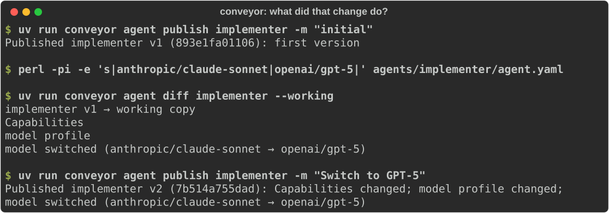
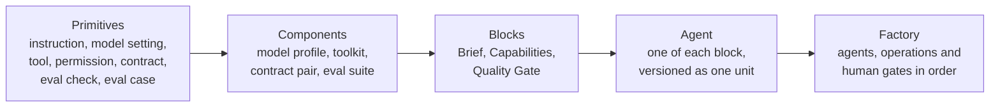
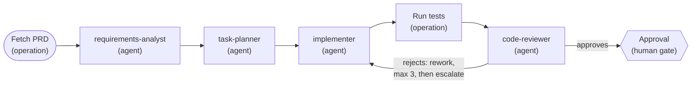

<h1 align="center">
  <picture>
    <source media="(prefers-color-scheme: dark)" srcset="docs/assets/conveyor-logo-dark.svg">
    
  </picture>
</h1>

<p align="center"><strong>Humans set the sat nav. Agents drive the route.</strong></p>

<p align="center">
  Open-source harness engineering for AI software factories: define the process, version every
  agent, gate each one on evals and measure what every change does to the output.
</p>

<p align="center">
  <a href="https://github.com/ReeceReynolds/Conveyor/actions/workflows/ci.yml"></a>
  <a href="LICENSE"></a>
  <a href="https://www.python.org/downloads/"></a>
</p>

<p align="center">
  <a href="#quickstart">Quickstart</a> ·
  <a href="#status">Status and roadmap</a> ·
  <a href="#how-it-works">How it works</a> ·
  <a href="docs/project-overview.md">Overview</a> ·
  <a href="examples/prd-to-pr/">Example factory</a> ·
  <a href="https://github.com/ReeceReynolds/Conveyor/discussions">Discussions</a>
</p>

You build a pipeline of agents. Someone tweaks a prompt or swaps a model, and nobody can say
what that did downstream. Conveyor is open-source infrastructure for **harness engineering**:
define an agent-driven software factory as plain files, give each agent one job and a quality
bar, and answer one question with evidence:

> **"I changed agent X. What did that do to the factory's output?"**

Today Conveyor defines and versions factories; running them, evals and outcome tracking are
next on the [roadmap](#status).

<p align="center">
  
</p>

## Quickstart

You need [git](https://git-scm.com/) and [uv](https://docs.astral.sh/uv/) 0.13 or newer
(uv fetches Python 3.14 for you). Clone the repository and go to the reference factory:

```bash
git clone https://github.com/ReeceReynolds/Conveyor
cd Conveyor/examples/prd-to-pr
```

Validate it, publish an agent, switch its model and see the change in factory-model terms:

```console
$ uv run conveyor validate .
Validated 4 agents and 1 factory: no problems found.

$ uv run conveyor agent publish implementer -m "initial"
Published implementer v1 (893e1fa01106): first version

$ perl -pi -e 's|anthropic/claude-sonnet|openai/gpt-5|' agents/implementer/agent.yaml

$ uv run conveyor agent diff implementer --working
implementer v1 → working copy
  Capabilities
    model profile
      model switched (anthropic/claude-sonnet → openai/gpt-5)
```

The first `uv run` also prints uv's environment setup. Version IDs are content hashes, so
yours will match. Or edit `capabilities.model.id` in
[`agent.yaml`](examples/prd-to-pr/agents/implementer/agent.yaml) by hand.

Keep going: publish the change and look at the history (your author and times will differ).

```console
$ uv run conveyor agent publish implementer -m "Switch to GPT-5"
Published implementer v2 (7b514a755dad): Capabilities changed; model profile changed; model switched (anthropic/claude-sonnet → openai/gpt-5)

$ uv run conveyor agent history implementer
v2  7b514a755dad  2026-11-10 23:51  root  Switch to GPT-5
v1  893e1fa01106  2026-11-10 23:51  root  initial
```

Versions live in `.conveyor/`, which is never committed. Delete it to start again.

**No clone:** Conveyor is not on PyPI yet, but uv can run the CLI straight from GitHub:

```bash
uvx --from git+https://github.com/ReeceReynolds/Conveyor conveyor --help
```

## Status

**Pre-alpha, built in public.** Conveyor defines and versions factories today. It does not
run them yet.

| Capability | State |
|---|---|
| Factory model: `agent.yaml` and factory files as strict, typed config with `file:line:column` errors | Works today |
| `conveyor validate`, including resolving each agent's input and output contracts | Works today |
| Published [JSON Schemas](schemas/) for editor validation and autocomplete | Works today |
| Agent registry: `publish`, `history`, `show`, `diff`, `list` with content-addressed versions | Works today ([milestone 2](docs/plans/milestone-2-agent-registry.md)) |
| [PRD → PR reference factory](examples/prd-to-pr/): defined and validated, placeholder prompts and empty evals | Works today (does not run) |
| Running factories as durable workflows, with bounded rework loops and human gates | Planned (M3) |
| Per-agent eval suites and quality gates, compared against the previous version on publish | Planned (M4) |
| Change sets: before and after for diffs, evals and factory outcome scores | Planned (M5) |
| Run logs as OpenTelemetry traces, with per-call cost | Planned |
| Local web interface (Factory Overview, Run Detail, Change Set Detail) | Planned (M6) |

Milestones are tracked in [`docs/plans/`](docs/plans/README.md); the full MVP scope is in the
[project overview](docs/project-overview.md#scope).

## What you can do with Conveyor

Today:

- **Define agents as files.** Each agent is a folder: `agent.yaml` (Brief, Capabilities,
  Quality Gate), `prompt.md` and `evals/`. See the
  [implementer](examples/prd-to-pr/agents/implementer/agent.yaml).
- **Define a factory.** Stages, operations, human gates, bounded rework loops and outcome
  scorers, in one [YAML file](examples/prd-to-pr/factories/prd-to-pr.yaml).
- **Type the handoffs.** Each Brief names a Pydantic model as its input and output, so one
  agent's output is exactly the next one's input ([`contracts.py`](examples/prd-to-pr/contracts.py)).
- **Catch mistakes early.** `conveyor validate` points at the exact line, for example
  `agents/implementer/agent.yaml:13:18: capabilities.model.temperature: input should be a valid number`.
- **Version agents immutably.** The same content always gets the same ID
  ([ADR 0013](docs/adr/0013-agent-version-identity.md)).
- **Review changes in plain words.** `diff` names the block, component and primitive that
  changed, with line diffs of instructions and eval files.
- **Gate CI on agent changes.** `diff --exit-code` exits `1` when versions differ, and the read
  commands never write ([ADR 0015](docs/adr/0015-read-only-store.md)).

Planned: run the factory, gate agents on evals, trace runs and see how a change moved the
outcome. See [Status](#status).

## How it works

Every factory is built from the same five levels. Each level is made of the one below it, so
you read a factory top down and improve it bottom up.



The [reference factory](examples/prd-to-pr/) takes a PRD to a pull request, started by hand
or by a labelled issue. Review can send work back to implementation, at most three times,
before the run escalates to a human:



The definition and contracts validate today; running it is milestone 3. The
[project overview](docs/project-overview.md) explains the model, concepts and design.

## Who it's for

- Engineers building multi-step agent pipelines who want each step to be a small, testable,
  versioned unit with one job.
- Teams that change prompts and models often and want a reviewable record of what changed.
- Anyone who wants agent configuration as plain, schema-checked files that live in Git.

Not a fit if you need agents running in production today or a hosted service, or want
open-ended multi-agent conversation (agents only hand off along the process you define).

## How it relates to other tools

Conveyor is narrow on purpose: a fixed, human-defined process, versioned agents and evidence
about change. It adopts established tools rather than replacing them.

- **Orchestration ([LangGraph](https://github.com/langchain-ai/langgraph),
  [CrewAI](https://github.com/crewAIInc/crewAI)).** General-purpose frameworks for agent
  control flow and multi-agent collaboration. Conveyor's process is a fixed pipeline; its focus
  is versioning each agent and linking changes to outcomes.
- **Evals and optimisation ([promptfoo](https://github.com/promptfoo/promptfoo),
  [DSPy](https://github.com/stanfordnlp/dspy)).** promptfoo tests and red-teams prompts and
  LLM apps; DSPy optimises prompts and weights programmatically. Conveyor plans per-agent
  quality gates on [Pydantic Evals](https://ai.pydantic.dev/evals/), tied to agent versions
  and factory outcomes. Humans make the changes.
- **Observability ([Langfuse](https://github.com/langfuse/langfuse),
  [Phoenix](https://github.com/Arize-ai/phoenix)).** Tracing and evaluation platforms for LLM
  apps. Conveyor plans to emit OpenTelemetry GenAI traces that you can export to them.

## Built on

- [Pydantic](https://docs.pydantic.dev/) v2 and JSON Schema 2020-12 for contracts and config
  ([ADR 0008](docs/adr/0008-contracts-and-configuration.md))
- ruamel.yaml for positioned YAML errors ([ADR 0009](docs/adr/0009-yaml-library.md))
- [Typer](https://typer.tiangolo.com/) for the CLI ([ADR 0010](docs/adr/0010-cli.md))
- SQLite via SQLAlchemy 2.0 and Alembic, plus a content-addressed object store
  ([ADR 0012](docs/adr/0012-storage.md))
- Planned: [Pydantic AI](https://ai.pydantic.dev/) for agent execution,
  [DBOS](https://github.com/dbos-inc/dbos-transact-py) for durable runs, Pydantic Evals and
  [OpenTelemetry](https://opentelemetry.io/)

Every choice is recorded in [`docs/adr/`](docs/adr/README.md); the full stack is in the
[project overview](docs/project-overview.md#technical-stack).

## CLI reference

| Command | What it does |
|---|---|
| `conveyor validate PATH` | Check an agent folder, a factory file or a project directory against the factory model |
| `conveyor agent list` | List the project's agents with their latest versions, marking those never published |
| `conveyor agent publish NAME -m MSG [--author TEXT]` | Validate `agents/NAME/` and publish it as the next version; does nothing if the content is unchanged |
| `conveyor agent history NAME` | List versions, newest first |
| `conveyor agent show NAME[@REF]` | Show a version's metadata, `agent.yaml` and file sizes |
| `conveyor agent diff NAME [FROM] [TO] [--working] [--summary]` | Compare the last two versions, any two, or a version with the folder on disk |

- A version is `latest`, `vN` or at least four hex characters of its content ID.
- `agent` commands take `--project PATH` (default: the current directory). Only `publish`
  writes; the others never create `.conveyor/`.
- Exit codes: `0` success, `1` problems (invalid agent, unknown version, unreadable registry),
  `2` usage error. With `diff --exit-code`, `1` means the versions differ and problems exit `2`.
- **Validating and publishing import the project's contract modules.** Only run them on
  projects whose code you trust.

## Why I'm building this

I'm [Reece Reynolds](https://github.com/ReeceReynolds), an engineering manager, and I'm
building Conveyor in public to explore harness engineering: the process, context and checks
that let agents do reliable work. My bet is that humans set the sat nav and agents drive the
route. What I keep missing is evidence: when I change an agent, I want to see what that did
to the output, not guess. Conveyor is how I'm testing that, one milestone at a time, with
every decision written down.

## Get involved

- **Follow along:** star or watch the repository to see each milestone land.
- **Ask or suggest:** [GitHub Discussions](https://github.com/ReeceReynolds/Conveyor/discussions).
- **Report a bug:** [open an issue](https://github.com/ReeceReynolds/Conveyor/issues).
- **Contribute:** read [`CONTRIBUTING.md`](CONTRIBUTING.md) and the current
  [milestone plan](docs/plans/README.md).
- **Bring your coding agent:** [`AGENTS.md`](AGENTS.md) and [`.claude/skills/`](.claude/skills/)
  give agents the same rules as humans ([ADR 0014](docs/adr/0014-agent-ready-repository.md)).

Participation is governed by the [Code of Conduct](CODE_OF_CONDUCT.md); report security issues
as described in [`SECURITY.md`](SECURITY.md).

## Development

Requirements: [uv](https://docs.astral.sh/uv/) ≥ 0.13, Python 3.14, Node 24 and
[pnpm](https://pnpm.io/) 11.

```bash
make install   # Python + UI dependencies and git hooks
make check     # everything CI runs: lint, strict types, tests, UI build
```

Run `make help` for all targets. Contributor and agent guidance lives in
[`CONTRIBUTING.md`](CONTRIBUTING.md) and [`AGENTS.md`](AGENTS.md); design decisions are
recorded in [`docs/adr/`](docs/adr/).

## Licence

[Apache-2.0](LICENSE)
